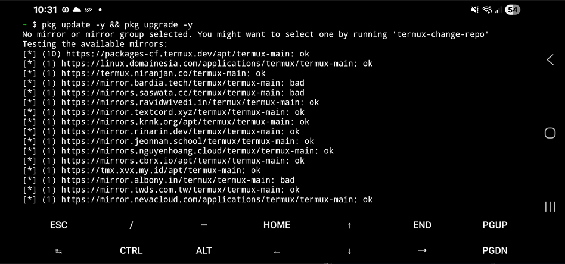
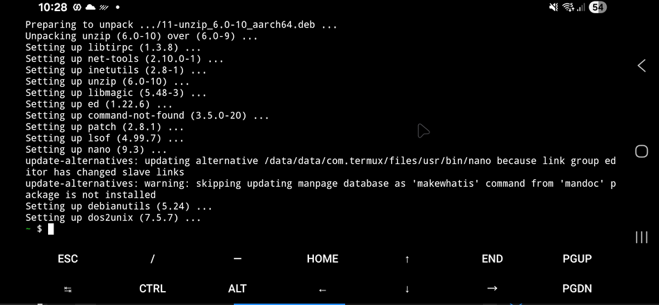
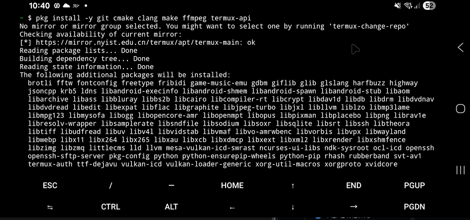
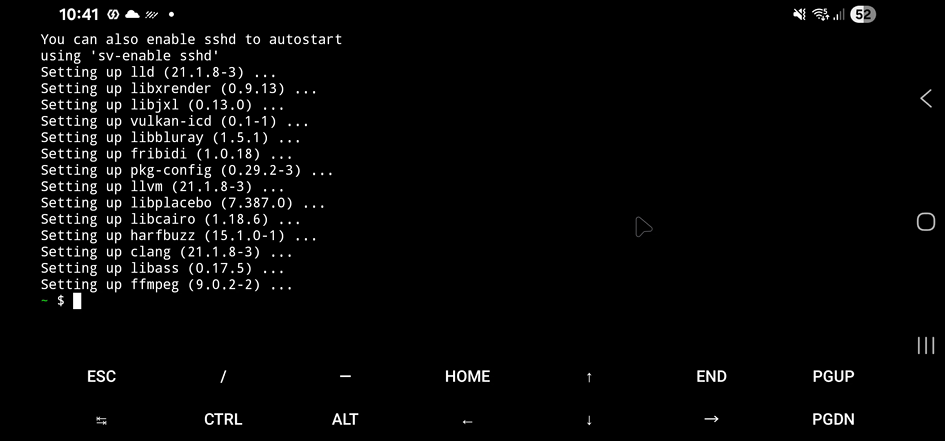
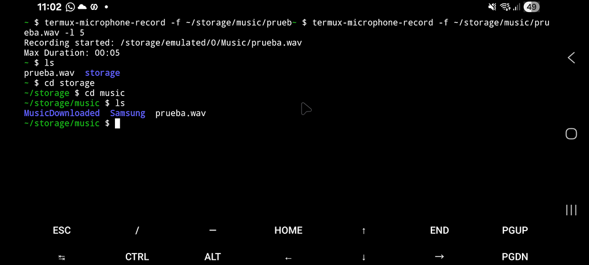

# Evidencia de comandos ejecutados y prueba de microfono

## Comandos empleados de actualización de paquetes e instalción de ffmpeg

- pkg update -y && pkg upgrade -y

- pkg install -y git cmake clang make ffmpeg termux-ap

## Prueba de microfono con evidencia de ejecución

-termux-microphone-record -f prueba.wav -l 5
ls -lh prueba.wav

