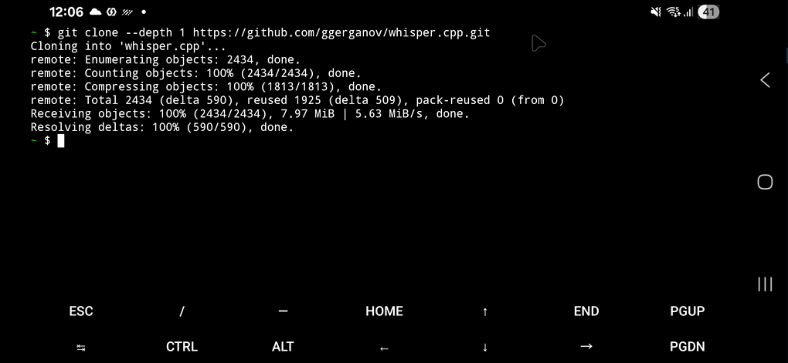
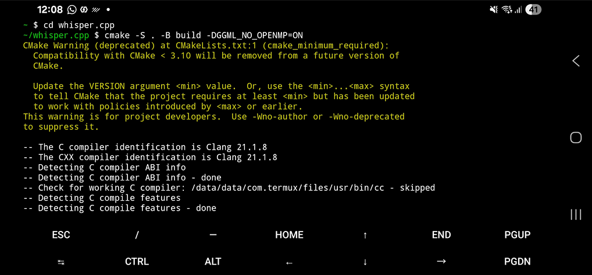
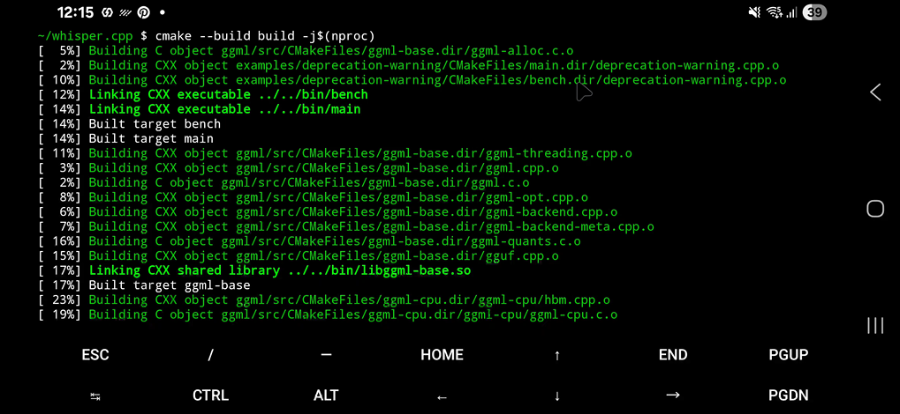
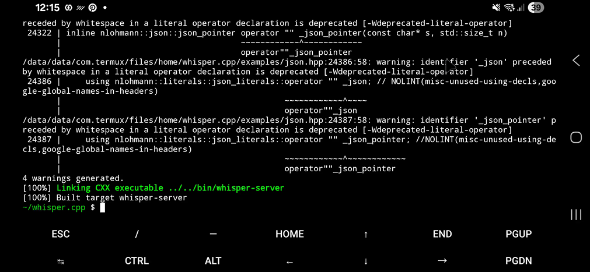
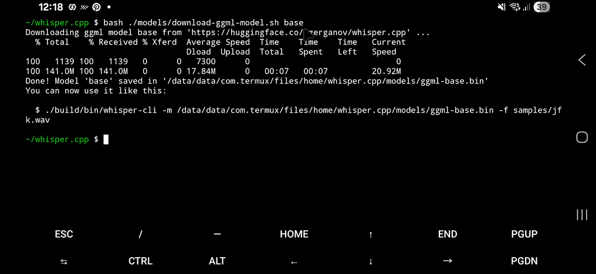
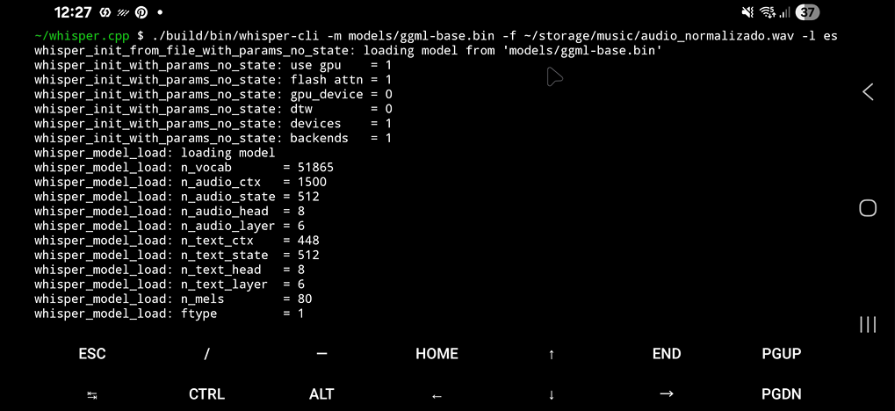
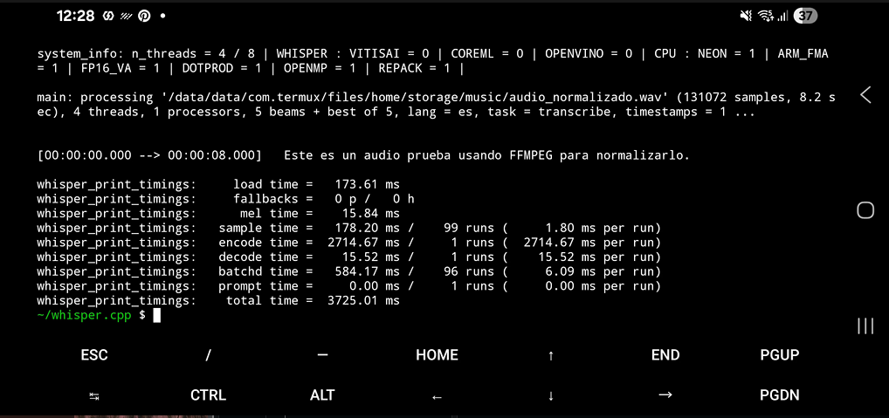

# Implementación de Whisper/STT

## Comandos para compilar whisper.cpp
git clone --depth 1 https://github.com/ggerganov/whisper.cpp.git
cd whisper.cpp
cmake -S . -B build -DGGML_NO_OPENMP=ON
cmake --build build -j$(nproc)

cd whisper.cpp
cmake -S . -B build -DGGML_NO_OPENMP=ON

cmake --build build -j$(nproc)

## Descarga del modelo Whisper

bash ./models/download-ggml-model.sh base

## Transcripción del modelo con el audio normalizado con FFmpeg
./build/bin/whisper-cli -m models/ggml-base.bin -f ~/storage/music/audio_normalizado.wav -l es

