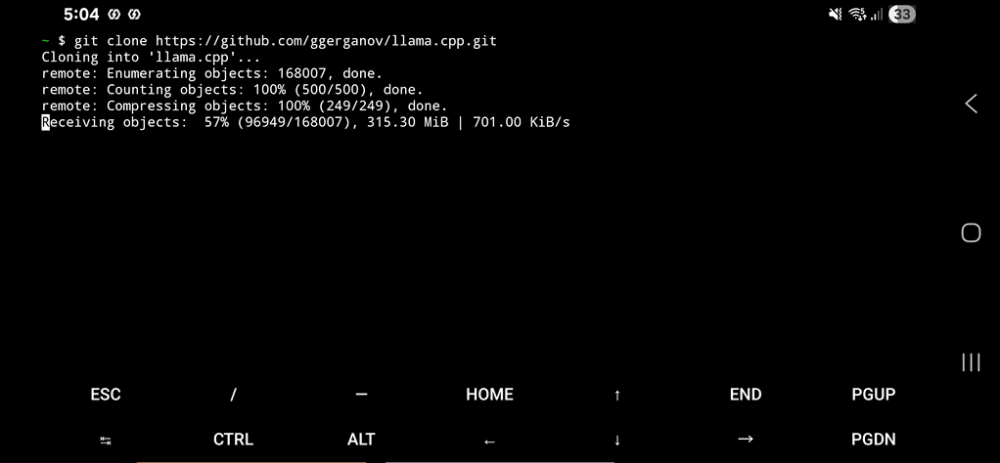
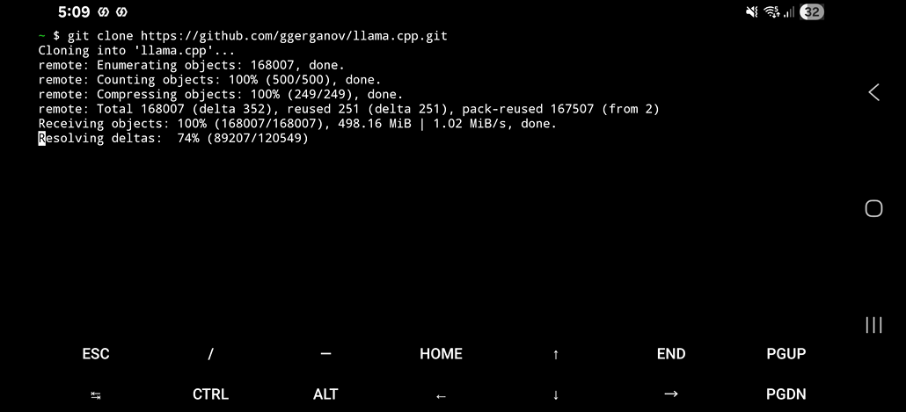
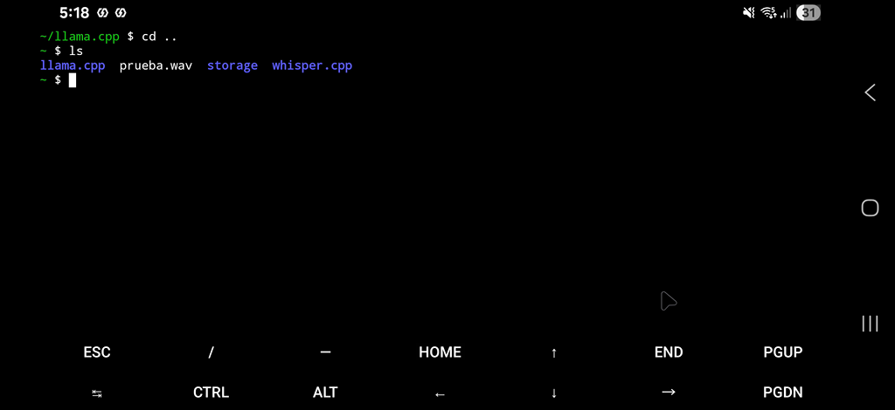
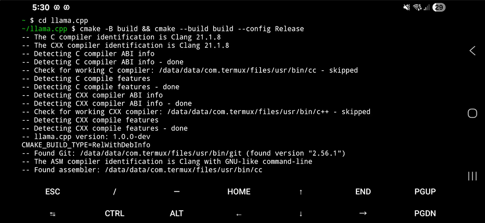
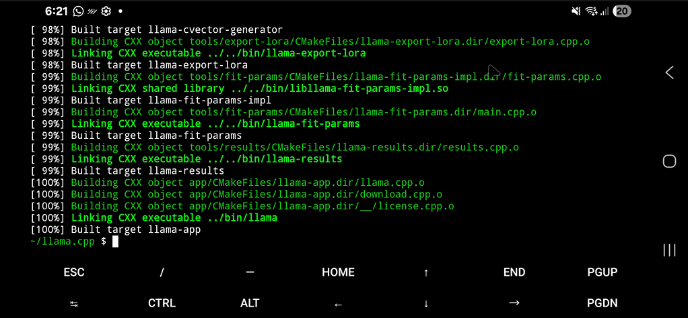

# Descarga y prueba respectiva del funcionamiento correcto del LLM

## Descargar el cargador de modelos llama.cpp

## Llama.cpp descargado y compilación del proyecto

## Iniciar LLM Qwen3.5-2B-Q4_K_M

## Prueba de 10 preguntas cortas con el chat del modelo

### Prueba 1

### Prueba 2

### Prueba 3

### Prueba 4

### Prueba 5

### Prueba 6

### Prueba 7

### Prueba 8

### Prueba 9

### Prueba 10

