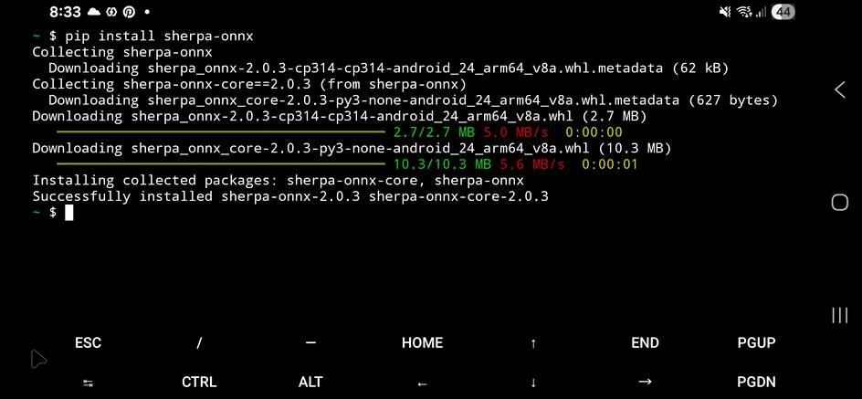
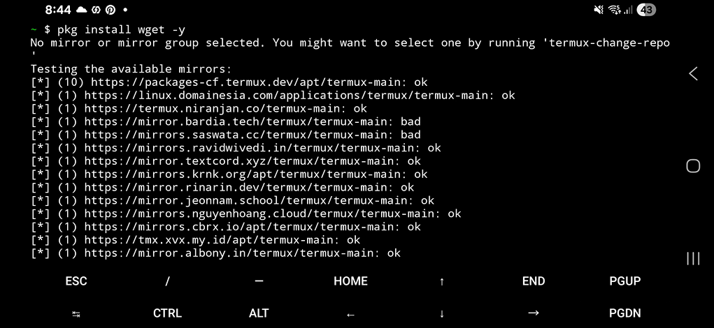
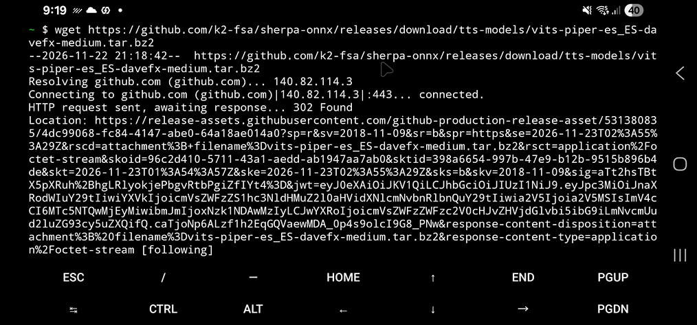
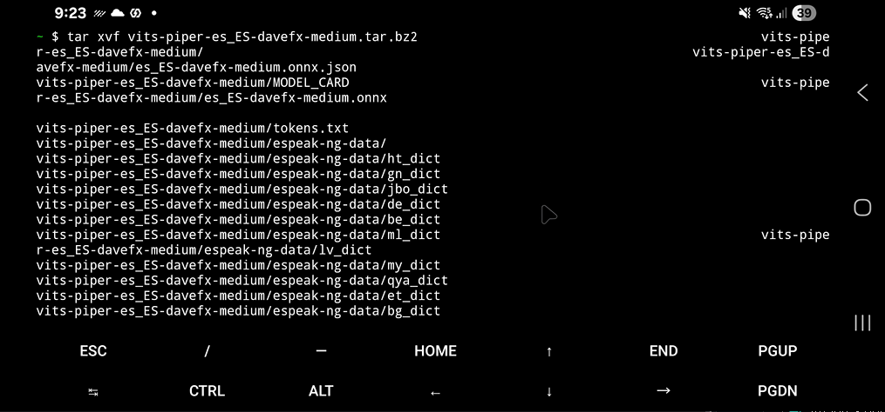
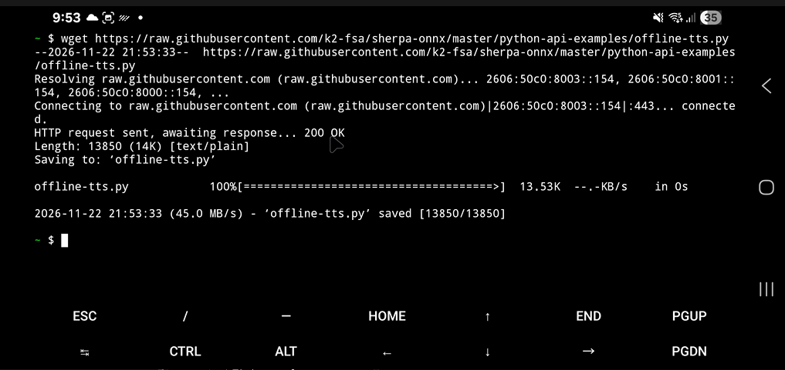
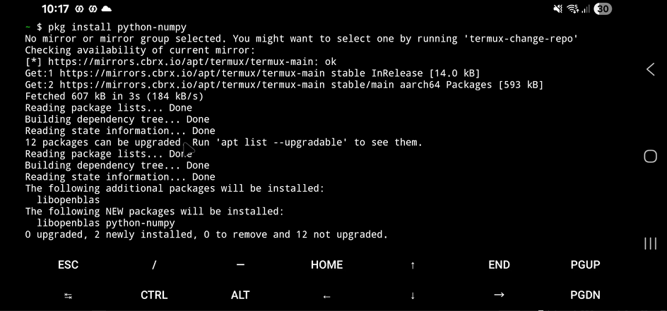
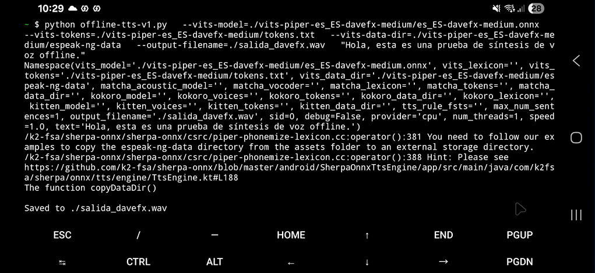
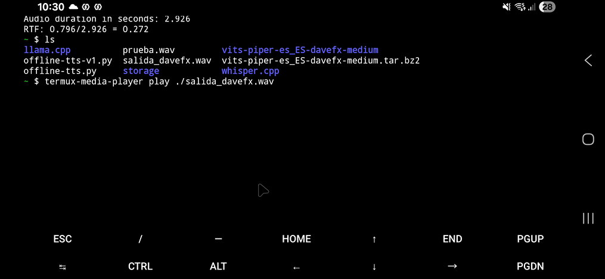

# Implementación e instalación del TTS (text to speech)

## Instalación del sintetizador de voz sherpa-onnx
pip install sherpa-onnx

## Descarga wget 

## Descargar modelo Piper en Español y descomprimir el mismo
wget https://github.com/k2-fsa/sherpa-onnx/releases/download/tts-models/vits-piper-es_ES-davefx-medium.tar.bz2

## Descargar scrip y libreria para el archivo de audio con python para la ejecución del sintetizador (python-numpy y soundifle)

## Comprobación de síntesis de TTS
### Descarga del script de prueba para el TTS

