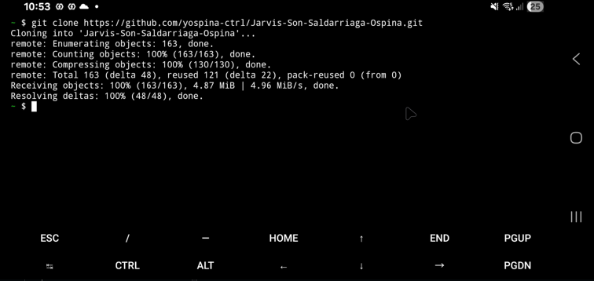
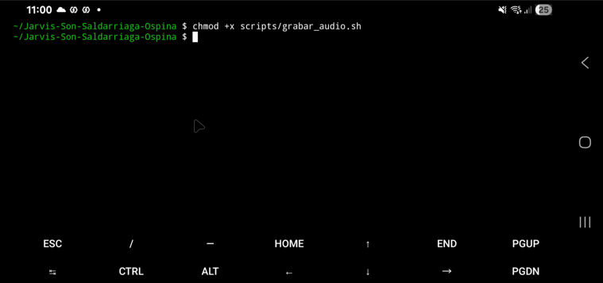

# Compilación y prueba de orquestador

## Clonar repositorio de github de proyecto Jarvis-Son para el main.cpp y cmake

## Compilar y probar orquestador
### 1. Configurar (esto creará la carpeta build)
cmake -B build

### 2. Compilar
cmake --build build

### 3. Dar permisos para permitir la captura de audio
chmod +x scripts/grabar_audio.sh

### 4. Ejecutar
./build/jarvis_orchestrator

